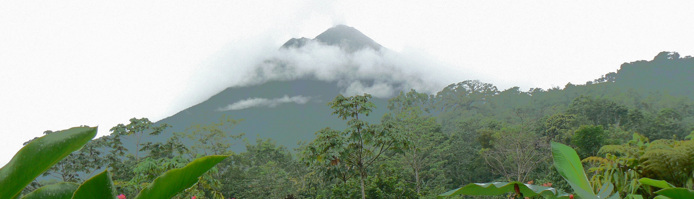
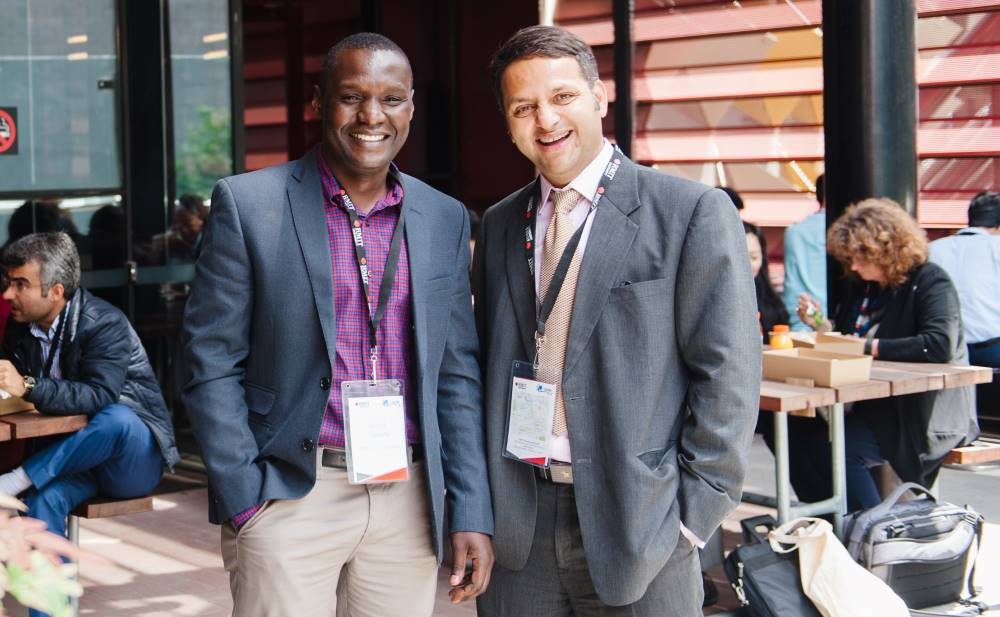
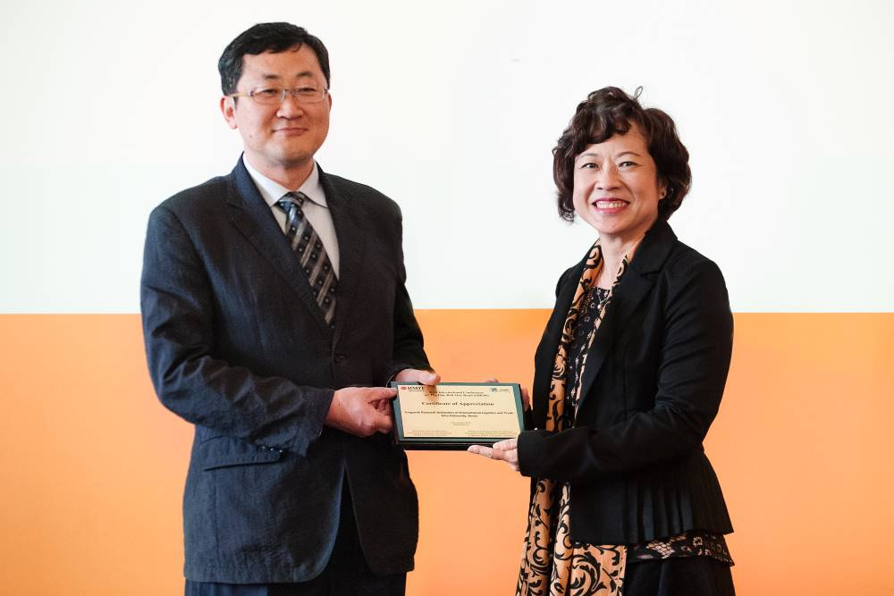
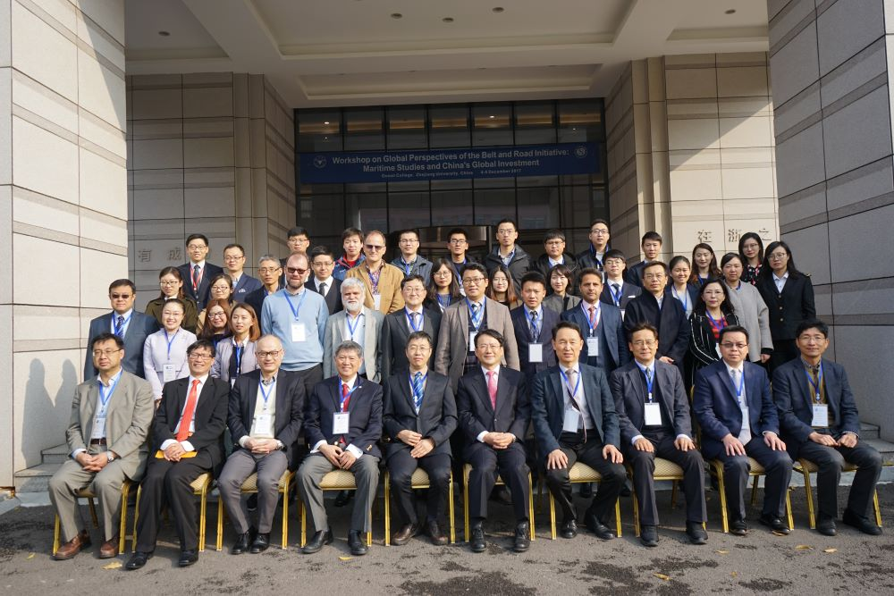
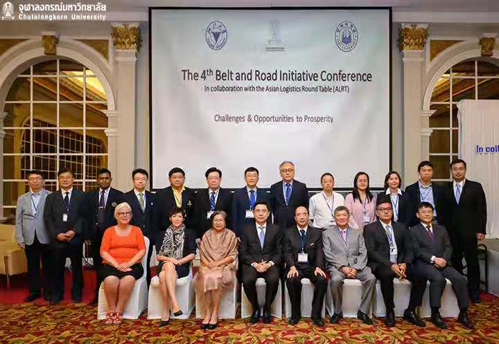

# The Global Research Network Belt and Road Initiative

# (Costa Rica Diary)

The Costa Rica diary tells and illustrates a cross-country tour of Costa Rica. Costa Rica is a beautiful tropical paradise in Central America, with a range of environments from rainforest to high mountain range. A highlight is the climb of Cerro Cirripo, a 3800m mountain in the central highlands and one of the highest in central America. Please sponsor me in this climb, as all the money received will be donated to charity (see the charity links pages).

[**Charity links →**](/who-we-are/)

* * *

* * *

## Value Propositions

* * *

## TRANSPARENCY & INTEGRITY

The network supports research with total commitment to integrity and transparency in promoting dissemination of evidence based research, academic knowledge and practical solutions to tackle existing and future challenges associated with the BRI.

## DIVERSITY AND INCLUSION

The network facilitates a wider access to an inclusive platform to diversified academic communities along BRI corridors to share, disseminate and collaborate.

## RESEARCH EXCELLENT AND IMPACT

The network promotes evidence based high quality research with high social and economic impact.

## COLLABORATION AND TRUST

The network promotes evidence based high quality research with high social and economic impact.

## The Scope

* * *

- Organise conferences at which various aspects of BRI.

- Encourage and assist the education and training.

- Take any other action to engage in or promote any activity that the Network considers desirable.

- Promote and provide for its Members a Newsletter and promote access to a journal or journals, conferences and other activities deemed appropriate by Council.

## Conferences

* * *

### Past Conferences

